<a href="https://subhanmalikk.com"><picture><source media="(prefers-color-scheme: dark) and (max-width: 600px)" srcset="assets/hero-phone-dark.svg"><source media="(max-width: 600px)" srcset="assets/hero-phone-light.svg"><source media="(prefers-color-scheme: dark)" srcset="assets/hero-dark.svg">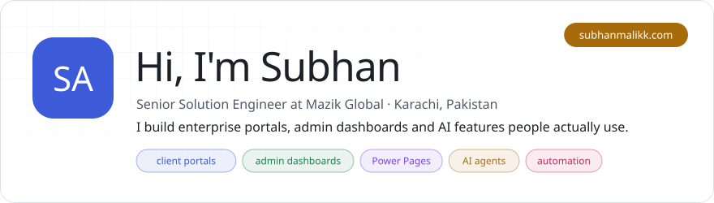</picture></a>

<a href="https://www.linkedin.com/in/muhammad-subhan-ali-4a636618a/"><picture><source media="(prefers-color-scheme: dark)" srcset="assets/badge-linkedin-dark.svg"></picture></a>
<a href="mailto:contact@subhanmalikk.com"><picture><source media="(prefers-color-scheme: dark)" srcset="assets/badge-email-dark.svg"></picture></a>
<a href="https://subhanmalikk.com"><picture><source media="(prefers-color-scheme: dark)" srcset="assets/badge-site-dark.svg"></picture></a>

## 192 contributions in the last year

<picture><source media="(prefers-color-scheme: dark) and (max-width: 600px)" srcset="assets/github-phone-dark.svg"><source media="(max-width: 600px)" srcset="assets/github-phone-light.svg"><source media="(prefers-color-scheme: dark)" srcset="assets/github-dark.svg">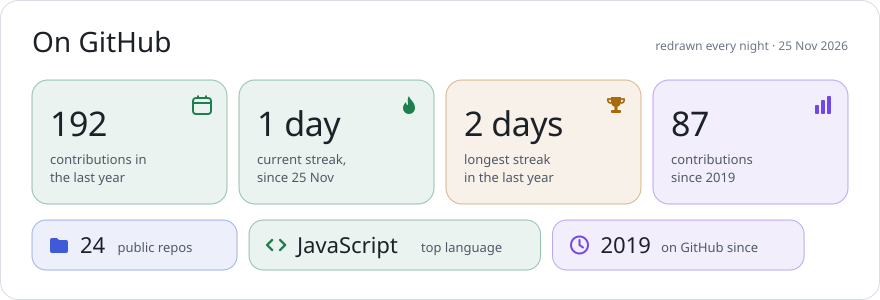</picture>

<picture><source media="(prefers-color-scheme: dark) and (max-width: 600px)" srcset="assets/graph-6m-phone-dark.svg"><source media="(max-width: 600px)" srcset="assets/graph-6m-phone-light.svg"><source media="(prefers-color-scheme: dark)" srcset="assets/graph-6m-dark.svg">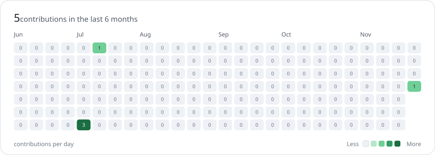</picture>

Last 12 months: 192 profile contributions

<picture><source media="(prefers-color-scheme: dark) and (max-width: 600px)" srcset="assets/graph-12m-phone-dark.svg"><source media="(max-width: 600px)" srcset="assets/graph-12m-phone-light.svg"><source media="(prefers-color-scheme: dark)" srcset="assets/graph-12m-dark.svg">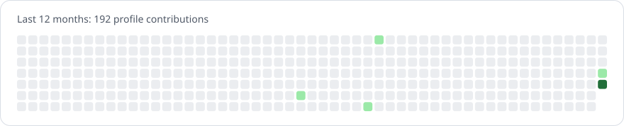</picture>

2026: 20 contributions

<picture><source media="(prefers-color-scheme: dark) and (max-width: 600px)" srcset="assets/graph-2026-phone-dark.svg"><source media="(max-width: 600px)" srcset="assets/graph-2026-phone-light.svg"><source media="(prefers-color-scheme: dark)" srcset="assets/graph-2026-dark.svg">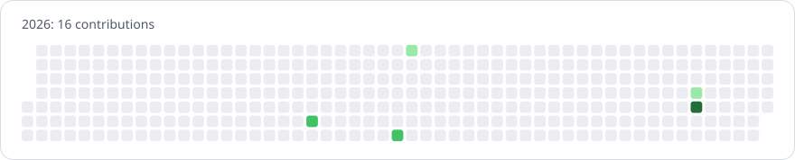</picture>

2025: 6 contributions

<picture><source media="(prefers-color-scheme: dark) and (max-width: 600px)" srcset="assets/graph-2025-phone-dark.svg"><source media="(max-width: 600px)" srcset="assets/graph-2025-phone-light.svg"><source media="(prefers-color-scheme: dark)" srcset="assets/graph-2025-dark.svg">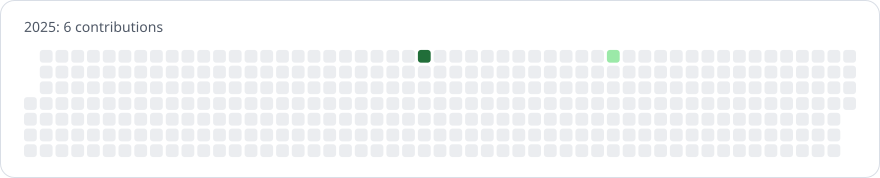</picture>

2024: 16 contributions

<picture><source media="(prefers-color-scheme: dark) and (max-width: 600px)" srcset="assets/graph-2024-phone-dark.svg"><source media="(max-width: 600px)" srcset="assets/graph-2024-phone-light.svg"><source media="(prefers-color-scheme: dark)" srcset="assets/graph-2024-dark.svg">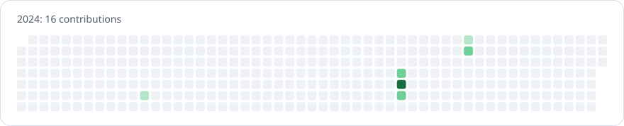</picture>

2023: 34 contributions

<picture><source media="(prefers-color-scheme: dark) and (max-width: 600px)" srcset="assets/graph-2023-phone-dark.svg"><source media="(max-width: 600px)" srcset="assets/graph-2023-phone-light.svg"><source media="(prefers-color-scheme: dark)" srcset="assets/graph-2023-dark.svg">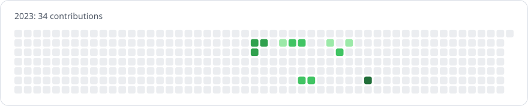</picture>

2022: 4 contributions

<picture><source media="(prefers-color-scheme: dark) and (max-width: 600px)" srcset="assets/graph-2022-phone-dark.svg"><source media="(max-width: 600px)" srcset="assets/graph-2022-phone-light.svg"><source media="(prefers-color-scheme: dark)" srcset="assets/graph-2022-dark.svg">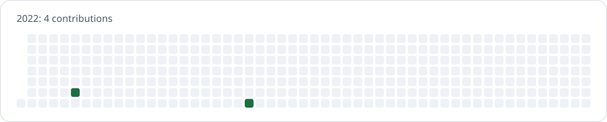</picture>

2021: 8 contributions

<picture><source media="(prefers-color-scheme: dark) and (max-width: 600px)" srcset="assets/graph-2021-phone-dark.svg"><source media="(max-width: 600px)" srcset="assets/graph-2021-phone-light.svg"><source media="(prefers-color-scheme: dark)" srcset="assets/graph-2021-dark.svg">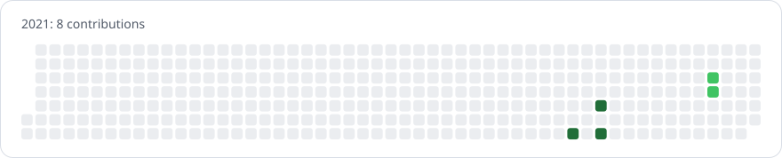</picture>

2020: 0 contributions

<picture><source media="(prefers-color-scheme: dark) and (max-width: 600px)" srcset="assets/graph-2020-phone-dark.svg"><source media="(max-width: 600px)" srcset="assets/graph-2020-phone-light.svg"><source media="(prefers-color-scheme: dark)" srcset="assets/graph-2020-dark.svg">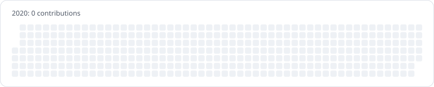</picture>

2019: 1 contribution

<picture><source media="(prefers-color-scheme: dark) and (max-width: 600px)" srcset="assets/graph-2019-phone-dark.svg"><source media="(max-width: 600px)" srcset="assets/graph-2019-phone-light.svg"><source media="(prefers-color-scheme: dark)" srcset="assets/graph-2019-dark.svg">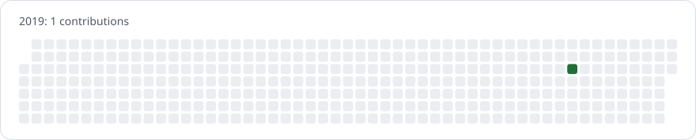</picture>

<picture><source media="(prefers-color-scheme: dark) and (max-width: 600px)" srcset="assets/line-30d-phone-dark.svg"><source media="(max-width: 600px)" srcset="assets/line-30d-phone-light.svg"><source media="(prefers-color-scheme: dark)" srcset="assets/line-30d-dark.svg">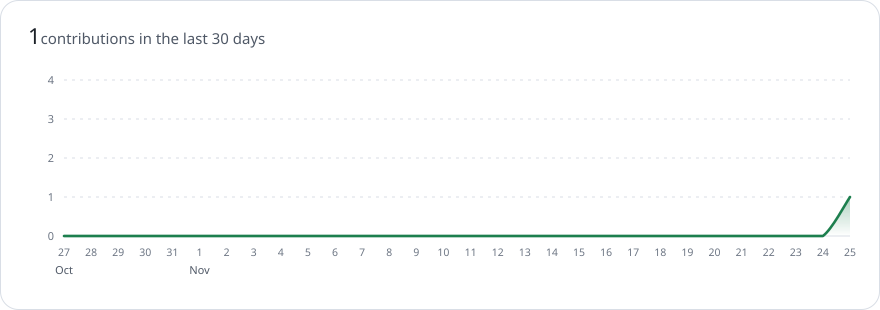</picture>

The annual total is my full-profile count. The six-month heatmap and 30-day wave use illustrative sample data, not actual daily activity. Yearly graphs and streaks use public GitHub data. <a href="https://github.com/SubhanMalik2000">View the full profile graph</a>.

<picture><source media="(prefers-color-scheme: dark) and (max-width: 600px)" srcset="assets/whoami-phone-dark.svg"><source media="(max-width: 600px)" srcset="assets/whoami-phone-light.svg"><source media="(prefers-color-scheme: dark)" srcset="assets/whoami-dark.svg">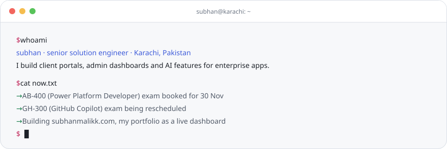</picture>

<picture><source media="(prefers-color-scheme: dark) and (max-width: 600px)" srcset="assets/label-build-phone-dark.svg"><source media="(max-width: 600px)" srcset="assets/label-build-phone-light.svg"><source media="(prefers-color-scheme: dark)" srcset="assets/label-build-dark.svg"></picture>

<picture><source media="(prefers-color-scheme: dark) and (max-width: 600px)" srcset="assets/project-company-formation-phone-dark.svg"><source media="(max-width: 600px)" srcset="assets/project-company-formation-phone-light.svg"><source media="(prefers-color-scheme: dark)" srcset="assets/project-company-formation-dark.svg">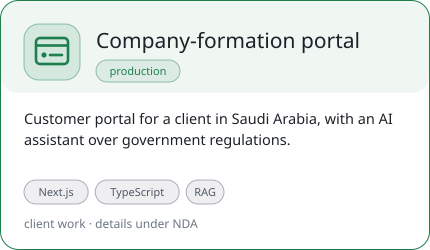</picture>
<picture><source media="(prefers-color-scheme: dark) and (max-width: 600px)" srcset="assets/project-d365-portals-phone-dark.svg"><source media="(max-width: 600px)" srcset="assets/project-d365-portals-phone-light.svg"><source media="(prefers-color-scheme: dark)" srcset="assets/project-d365-portals-dark.svg">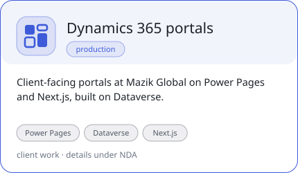</picture>
<a href="https://github.com/SubhanMalik2000/ai-sentinel-sdk"><picture><source media="(prefers-color-scheme: dark) and (max-width: 600px)" srcset="assets/project-ai-sentinel-phone-dark.svg"><source media="(max-width: 600px)" srcset="assets/project-ai-sentinel-phone-light.svg"><source media="(prefers-color-scheme: dark)" srcset="assets/project-ai-sentinel-dark.svg">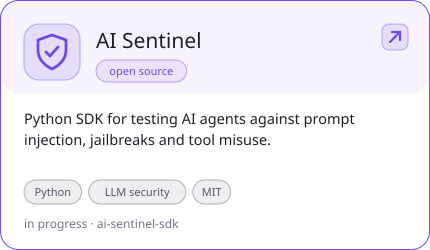</picture></a>
<a href="https://subhanmalikk.com"><picture><source media="(prefers-color-scheme: dark) and (max-width: 600px)" srcset="assets/project-portfolio-phone-dark.svg"><source media="(max-width: 600px)" srcset="assets/project-portfolio-phone-light.svg"><source media="(prefers-color-scheme: dark)" srcset="assets/project-portfolio-dark.svg">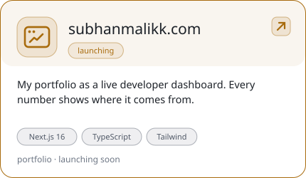</picture></a>

Client work is under NDA, so it's described in general terms.

<picture><source media="(prefers-color-scheme: dark) and (max-width: 600px)" srcset="assets/label-stack-phone-dark.svg"><source media="(max-width: 600px)" srcset="assets/label-stack-phone-light.svg"><source media="(prefers-color-scheme: dark)" srcset="assets/label-stack-dark.svg"></picture>

<picture><source media="(prefers-color-scheme: dark) and (max-width: 600px)" srcset="assets/stack-phone-dark.svg"><source media="(max-width: 600px)" srcset="assets/stack-phone-light.svg"><source media="(prefers-color-scheme: dark)" srcset="assets/stack-dark.svg"></picture>

<picture><source media="(prefers-color-scheme: dark) and (max-width: 600px)" srcset="assets/label-certs-phone-dark.svg"><source media="(max-width: 600px)" srcset="assets/label-certs-phone-light.svg"><source media="(prefers-color-scheme: dark)" srcset="assets/label-certs-dark.svg"></picture>

<picture><source media="(prefers-color-scheme: dark) and (max-width: 600px)" srcset="assets/certs-phone-dark.svg"><source media="(max-width: 600px)" srcset="assets/certs-phone-light.svg"><source media="(prefers-color-scheme: dark)" srcset="assets/certs-dark.svg">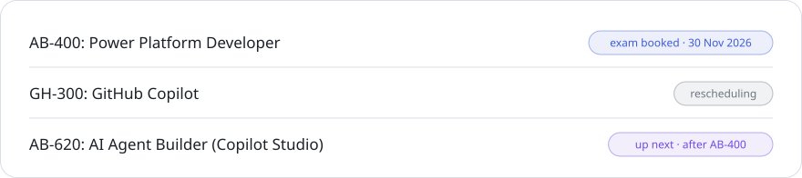</picture>

Cards redrawn every night from public GitHub data by a GitHub Action in this repo · <a href="https://subhanmalikk.com">subhanmalikk.com</a>

